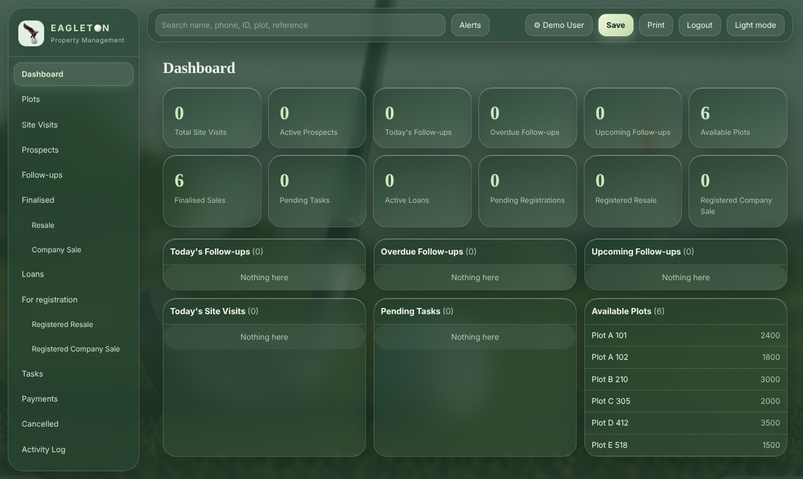
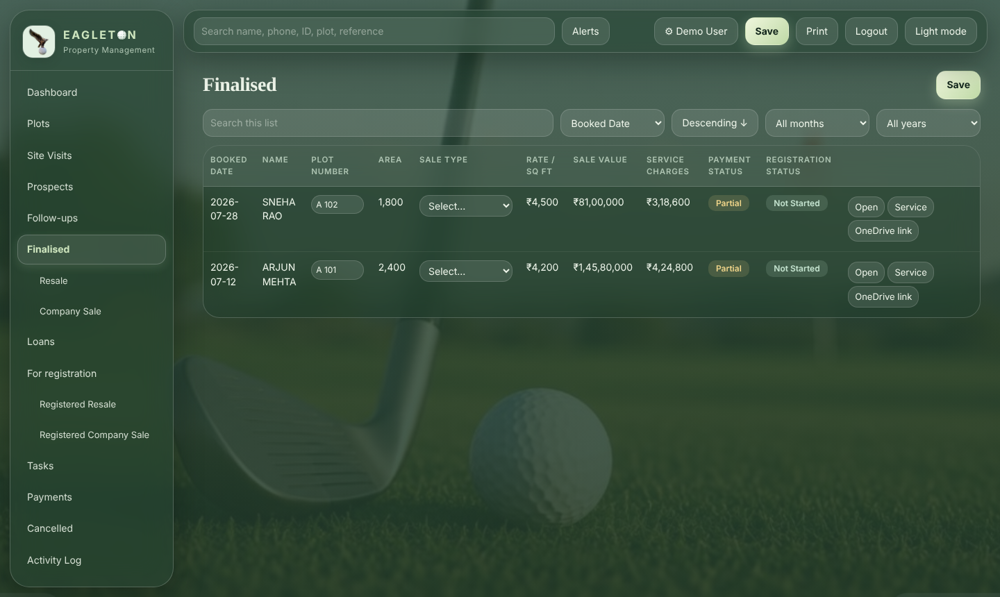
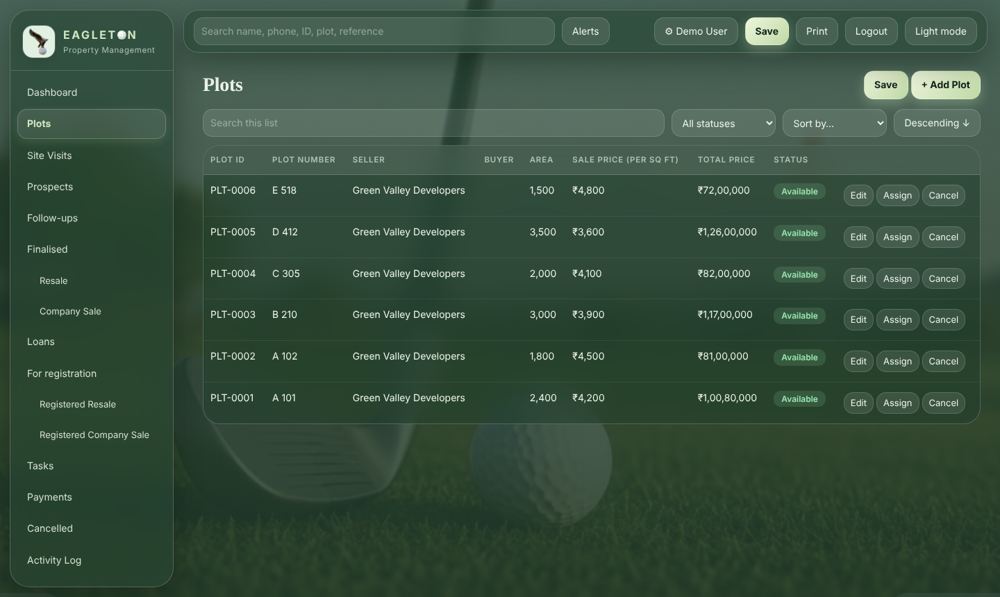
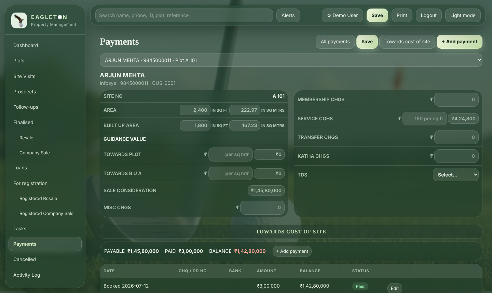

<p align="center"></p>

# EAGLETON · Property Management

A web app for a real-estate office: **site visits, prospects, follow-ups, plots, finalised sales (resale and
company sale), loans, registrations and payments** in one calm, pastel golf-green interface.

> Screenshots below use made-up demo data.

| Dashboard | Finalised sales |
|---|---|
|  |  |
| **Plots** | **Payment statement** |
|  |  |

## Features
- Role-free office sign-in with hashed passwords, rate-limited login, password reset by email code
- Site-visit → prospect → finalised pipeline; resale / company sale tabs with totals on top
- Plot inventory with seller, buyer auto-linking and status tracking
- **Payment statement** with live calculations: sale consideration (area × rate + B U A), guidance value,
  service charges + GST (company sales are exempt), TDS, balance and payment status
- Loans, registrations, tasks, follow-ups, searchable activity log, alerts
- Indian number formatting, light/dark mode, print layout, works on phones

## Tech
Node.js (no dependencies) · vanilla JavaScript front end · business rules in `backend/Code.gs` ·
JSON file database · deployable to any Node host with a persistent disk.

## Run it
```bash
node -v        # 20.12 or newer
npm start      # then open http://localhost:3000
```
Full walkthrough (moving data, GitHub, publishing): see [GUIDE.md](GUIDE.md).

## Settings (`.env`)
| Name | Meaning |
|---|---|
| `PORT` | port (default 3000) |
| `SIGNUP_CODE` | code needed to create an account |
| `DATA_DIR` | folder for the database file |
| `ADMIN_KEY` | enables the one-time data upload; remove it afterwards |

## Project layout
```
server.js              web server + /api endpoint
backend/Code.gs        business logic and validation
backend/gas-runtime.js runs Code.gs locally, stores data in data/db.json
public/                interface (index.html), images
scripts/               import / upload helpers
tools/Export.gs        exports data from the old Google Sheet
```


## Roles (who can change what)

| Role | Can change | Everything else |
|------|-----------|-----------------|
| admin | everything | - |
| sales | Site visits and Prospects | read only |
| legal | Plots and For registration | read only |

New sign-ups start as **sales**. Existing accounts become **admin** on the first start after updating. An admin gives roles on the **Users** page.
